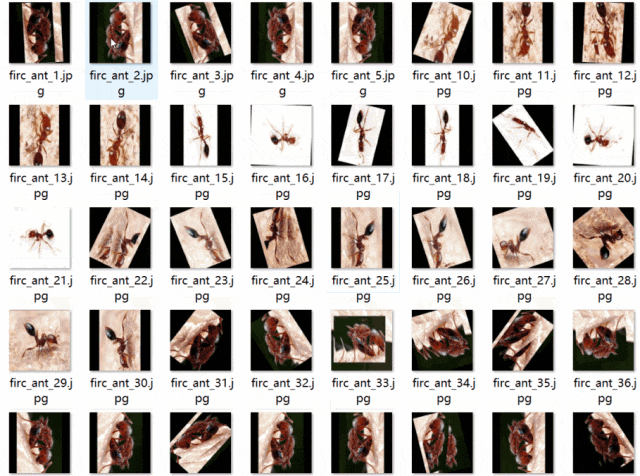
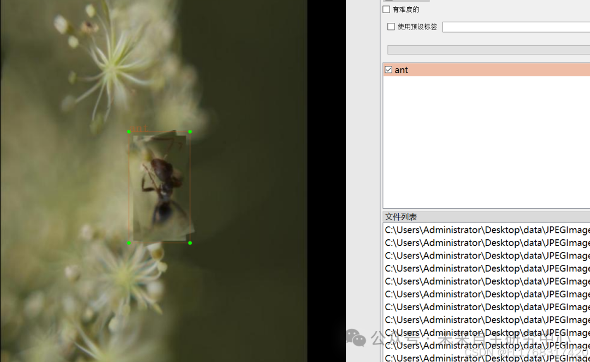

# Red-fire ant detection dataset VOC+YOLO format with 9505 images in 1 category

Dataset format: Pascal VOC format + YOLO format (txt file without split path, only containing jpg images and corresponding VOC format xml files and yolo format txt files)
Number of images (number of jpg files): 9505
Number of annotations (number of xml files): 9505
Number of annotations (number of txt files): 9505
Number of annotation categories: 1
Annotation category names: ["ant"]
Number of bounding boxes per category:
Ant bounding box count = 55741
Total bounding box count: 55741
Using annotation tool: labelImg
Annotation rules: draw a rectangle around the category
Important note: Most of the images in the dataset are enhanced, please carefully review the images before downloading.
Special declaration: This dataset does not guarantee the accuracy or weights of the trained models or weight files, only accurate and reasonable annotations are provided.

Image Preview:

Annotation example:

## Payment

Here is a pay link on Stripe ( https://buy.stripe.com/3cs8yP7sY87d0vu9AB ). Please contact me lonlonago@foxmail.com after funding $89, and I will send you a complete data files , thank you!

